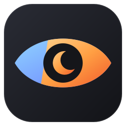

# Saio

Screen color filters for Windows: tint, invert, or desaturate any part of the screen (or the whole screen) without hiding what's underneath.

## How it works

Saio uses the Windows **Magnification API**. Each region is a click-through window that shows a live copy of the screen beneath it, passed through a 5×5 color matrix. Because the filter *transforms* pixels rather than painting over them, a 100%-intensity warm filter still shows everything underneath, just warmer.

> **Hybrid graphics (laptops with two GPUs):** the magnifier renders pure black if the program runs on a different GPU than the one the monitors are connected to. On startup Saio sets its own Windows GPU preference (Settings → Display → Graphics), checks that a filter actually renders, and if not, switches to the other GPU and restarts once. While running from source this preference is stored for `python.exe`; the packaged `.exe` will get its own entry.

## Filters

| Filter | Effect |
| --- | --- |
| Warm / Amber | Blue-light reduction (channel multiply) |
| Custom | Multiply by any color you pick |
| Grayscale | Remove color |
| Negative | Invert colors |
| Dark paper | Inverted grayscale, so white pages become dark |
| Sepia | Paper-like reading tone |
| Red night | Monochrome red, keeps night vision |
| Red-weak / Green-weak / Blue-weak | Color-vision assist (daltonization) for protan, deutan and tritan color blindness |
| Dim only | No color change, just brightness |

**Intensity** blends from "no filter" to the full filter. **Brightness** dims the result.

## Download

Grab `Saio.exe` from the [latest release](https://github.com/TurhanErgene/Saio/releases/latest) and run it. No install or Python needed (Windows 10/11).

The exe isn't code-signed, so Windows SmartScreen may warn on first launch: click **More info → Run anyway**.

## Run from source

```
python -m venv .venv
.venv\Scripts\pip install -r requirements.txt
.venv\Scripts\python main.py
```

### Build the exe

```
.venv\Scripts\pip install pyinstaller
.venv\Scripts\pyinstaller saio.spec
```

The result is `dist\Saio.exe`. Pushing a tag like `v2.0.0` builds it on GitHub Actions and attaches it to a release automatically.

## Usage

- **Add region**: drag a rectangle on any monitor. Add as many as you like.
- **Move / resize**: unlock regions, then drag them or their edges. Double-click a region (or toggle the button again) to lock it. Right-click a region to remove it.
- **Pick app**: click any window, and every window of that program gets its own filter (e.g. Negative for a PDF reader, Warm everywhere else). The filter follows the window as it moves, stays behind windows in front of it, and pauses while the app is minimized.
- **Whole screen**: applies the filter to the entire display instead of regions and apps.
- Closing the window keeps Saio running in the tray. Use the tray icon to reopen it or quit.
- Settings and regions are remembered between runs.

### Global shortcuts

| Keys | Action |
| --- | --- |
| Ctrl+Alt+F | Filter on/off |
| Ctrl+Alt+R | Add region |
| Ctrl+Alt+E | Move / resize regions |
| Ctrl+Alt+A | Pick an app to filter |
| Ctrl+Alt+= / Ctrl+Alt+- | Intensity up / down |

## Layout

```
main.py            entry point
saio/app.py        control panel, tray, settings, wiring
saio/region.py     filtered region window (magnifier host)
saio/apps.py       per-app filters: window tracking + picker
saio/selector.py   drag-to-select overlay
saio/filters.py    color matrices
saio/hotkeys.py    global hotkeys
saio/gpu.py        picks the GPU that drives the displays (hybrid laptops)
saio/winapi.py     ctypes bindings (Win32 + Magnification)
saio/theme.py      colors and stylesheet
saio/widgets.py    toggle switch, sliders, previews, icons
saio/assets/       logo (SVG tile + glyph, .ico, preview PNG)
tools/make_icons.py  regenerates everything in saio/assets
saio.spec          PyInstaller build (with version_info.txt)
```

## License

[GPL-3.0](LICENSE). Saio is built on PyQt5, which is GPL-licensed.
